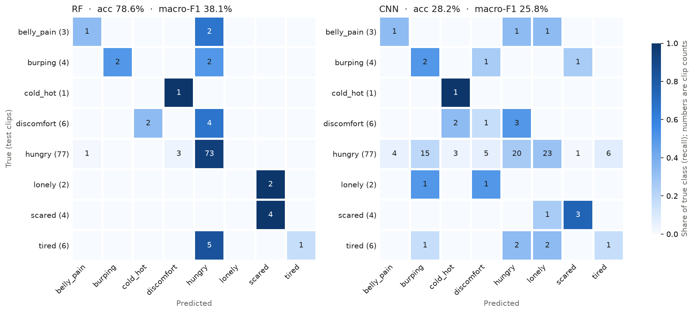

# Infant State Recognition from Cry Audio 👶🔊

[](https://github.com/techatanu/Infant-State-Recognition-System/actions/workflows/tests.yml)

Parents often can't tell why a baby is crying. This project classifies a short infant cry recording into one of **8 need states**: hungry, tired, discomfort, belly pain, burping, scared, lonely, and cold/hot.

**Live demo:** _coming soon_ at [Hugging Face Space](https://huggingface.co/spaces/USERNAME/SPACE_NAME) (placeholder; see [deploy guide](docs/DEPLOY_HF_SPACE.md)).

## Approach

The work started in [`Baby_Cry_Scene.ipynb`](Baby_Cry_Scene.ipynb) on Google Colab. That notebook is kept unchanged. The same pipeline now also runs as scripts in [`src/`](src/), with a CNN, an evaluation script, tests and a demo added.

1. **Data cleaning.** The dataset has 512 labelled `.wav` clips. Silence is trimmed with a 30 dB threshold, and clips that are corrupt, shorter than 1 second after trimming, or more than 80% silent are dropped, leaving **511 clips**.
2. **Feature engineering.** Each clip becomes a **218-dimensional vector**, built from the mean and standard deviation over time of:
   - MFCC and delta-MFCC
   - zero-crossing rate, spectral centroid and RMS energy
   - chroma, a 40-band log-mel spectrogram, spectral contrast and tonnetz

   The audio uses 22,050 Hz sampling with 25 ms windows and a 10 ms hop.
3. **Handling imbalance.** The data is heavily imbalanced: "hungry" has 381 clips and "cold_hot" has 7, a 54:1 ratio. The split is stratified 80/20, the scaler is fit on training data only to avoid leakage, and **balanced class weights** are used.
4. **Model 1: Random Forest.** A cost-sensitive **Random Forest** with 300 trees, evaluated with 5-fold stratified cross-validation ([`src/train_rf.py`](src/train_rf.py)).
5. **Model 2: CNN.** A small PyTorch CNN ([`src/train_cnn.py`](src/train_cnn.py), [`src/model.py`](src/model.py)) that learns from the spectrogram instead of hand-made features:
   - **Input:** a 64-band log-mel spectrogram, padded or cropped to 7 s (64 × 603). About 90% of trimmed clips are 7 s or shorter.
   - **Network:** each mel band is normalised first, then 4 double-conv blocks (16→32→64→128 channels). It averages over frequency, then takes max + mean over time, so a short loud cry isn't averaged away by silence.
   - **Training:** class-weighted cross-entropy, stratified 5-fold CV on the training split, and early stopping on validation loss. The final model is retrained on the whole training split for the median best epoch (59).
   - **Augmentation, on training folds only:** time shift (±0.5 s), pitch shift (±1–2 semitones), Gaussian noise (25–40 dB SNR) and SpecAugment frequency/time masks. Validation and test clips are never augmented.

Both models are scored on **the same 103 test clips** by [`src/evaluate.py`](src/evaluate.py).

## Results

| Metric | RF | CNN |
|---|---|---|
| Test accuracy | **78.6%** [71–86%] | 28.2% [19–36%] |
| Test macro F1 | **38.1%** [23–48%] | 25.8% [13–36%] |
| 5-fold CV macro F1 (training split) | **0.421 ± 0.054** | 0.254 ± 0.072 |
| F1 belly_pain (3 test clips) | 0.40 | 0.25 |
| F1 burping (4) | 0.67 | 0.17 |
| F1 cold_hot (1) | 0.00 | 0.29 |
| F1 discomfort (6) | 0.00 | 0.14 |
| F1 hungry (77) | 0.90 | 0.39 |
| F1 lonely (2) | 0.00 | 0.00 |
| F1 scared (4) | 0.80 | 0.67 |
| F1 tired (6) | 0.29 | 0.15 |

Brackets are 95% bootstrap intervals over the test clips. Full reports are in [`reports/`](reports/results.md).



**Why these numbers differ from the notebook (81.6% / 32.0% / 0.309).** The scripts use the same preprocessing, features, model and seed. The difference is *which* 103 clips end up in the test set. The notebook split the clips in the order Google Drive listed them; the scripts sort filenames first so the split is the same on every machine. With 1–6 test clips for most classes, that alone moves the score a lot: over 20 different random splits, the same RF gets macro F1 **0.47 ± 0.10** (range 0.29–0.65). Both the old and new numbers are inside that range.

**Honest read:** the CNN is **worse** than the Random Forest on every summary metric, in cross-validation and on the test set. With about 400 training clips, mostly "hungry", a network learning from raw spectrograms has too little data. The hand-made features give the RF a head start. The RF's accuracy still looks good mainly because about 75% of the test set is "hungry", which it detects well (F1 0.90). Scared (F1 0.80) and burping (F1 0.67) also work. Discomfort, lonely and cold/hot are not recognised at all. **Macro F1 is still the metric to improve.**

## Leakage check

Two problems in the dataset make every score above look better than it would on new babies:

- **Same audio, two labels.** 9 clips in `discomfort/` are 8 kHz copies of clips that also sit in another folder: all 7 `cold_hot` clips, plus one `hungry` and one `lonely`. The audio is identical, so the same sound has two different "correct" answers.
- **Same recording source on both sides of the split.** Filenames start with a UUID that identifies the recording source, and there are only 247 of them for 511 clips. 71 of the 103 test clips share a recording source with training clips.

To measure the effect, the RF was cross-validated again with the duplicates removed and with folds grouped by recording source ([`reports/leakage_check.md`](reports/leakage_check.md); 5-fold CV × 3 seeds):

| Setup | RF CV macro F1 |
|---|---|
| As-is: all clips, clip-level folds | 0.482 ± 0.082 |
| Duplicates removed, clip-level folds | 0.502 ± 0.082 |
| Duplicates removed, **folds grouped by recording source** | **0.347 ± 0.059** |

**Honest read:** about 0.15 macro F1 disappears when the model can't see clips from the same source during training. **~0.35 is the more realistic estimate for new babies.** The main results above keep the notebook's split so they stay comparable; the CNN was not re-run grouped (about 3 hours on CPU).

## Error analysis

Based on [`reports/test_predictions.csv`](reports/test_predictions.csv) and the confusion matrices above:

- **The RF mostly defaults to "hungry".** 13 of the 26 non-hungry test clips are predicted "hungry", including 5 of 6 tired, 4 of 6 discomfort and 2 of 4 burping. Balanced class weights help, but the hungry class still dominates the trees.
- **The RF predicts every lonely clip as scared** (2 of 2). Those two classes may sound alike, but with only 11 lonely clips in total it's hard to say.
- **The CNN over-corrects.** The class weights make the rarest class cost about 50× more to miss than "hungry", so it spreads hungry clips across every class: 23 of 77 go to lonely and 15 to burping, and only 20 are right. That explains its 28% accuracy.
- **Some "errors" are label conflicts.** All three RF mistakes between cold_hot and discomfort are duplicate copies: the test clip's identical audio is in training under the other label. The model recognises the sound correctly; the labels disagree.
- **Confidence doesn't help.** The RF's top probability averages 0.43 on correct predictions and 0.44 on wrong ones, so a confidence threshold wouldn't filter out mistakes.
- **The rare-class scores are mostly noise.** cold_hot has 1 test clip and lonely has 2, so one prediction changes their F1 between 0 and 1. The CNN's cold_hot F1 of 0.29 is one lucky clip.

## Run it

**Setup** (Python 3.11):

```bash
python3.11 -m venv .venv && source .venv/bin/activate
pip install -r requirements-dev.txt          # add requirements-app.txt for the demo
cp .env.example .env                         # then set BABYCRY_DATA_DIR to the dataset folder
```

The dataset (one sub-folder per class) stays outside the repo and is read from `BABYCRY_DATA_DIR`. It is never copied or committed.

**Train and evaluate:**

```bash
python -m src.train_rf        # ~1 min; features are cached in data/cache/
python -m src.train_cnn       # ~1 h on CPU (5-fold CV + final retrain)
python -m src.evaluate        # tables, confusion matrices, leakage check -> reports/
```

**Tests** (synthetic audio, no dataset needed; also run by GitHub Actions on pushes to main and on pull requests):

```bash
pytest
```

**Demo** (upload a `.wav`, see the top-3 predicted states):

```bash
pip install -r requirements-app.txt
python app.py                 # http://127.0.0.1:7860
```

To deploy it as a Hugging Face Space, see [`docs/DEPLOY_HF_SPACE.md`](docs/DEPLOY_HF_SPACE.md).

**Notebook:** to use the original Colab version, put the dataset on Google Drive, update `CONFIG['dataset_path']` in Cell 2 and run all cells.

<details>
<summary>Project structure</summary>

```
src/config.py       paths (from .env) and all audio/model parameters
src/data.py         indexing, cleaning, the shared 80/20 split, leakage helpers
src/features.py     218-dim features, fixed-length 64-band log-mel
src/train_rf.py     Random Forest baseline     -> models/rf.joblib
src/model.py        CNN definition + inference helpers
src/train_cnn.py    CNN training with CV        -> models/cnn.pt
src/evaluate.py     RF vs CNN on the test split -> reports/
app.py              Gradio demo
tests/              pytest suite on synthetic audio
```
</details>

## Next steps

- [x] Data augmentation: pitch shift, time shift, added noise and SpecAugment (CNN, training folds only).
- [x] A CNN on log-mel spectrograms, compared against the Random Forest. It lost.
- [x] Confusion matrix and per-class error analysis.
- [x] Save the models and add a Gradio demo for Hugging Face Spaces.
- [ ] Fix the data: drop the 9 duplicates and make grouping by recording source the main split.
- [ ] Try a pretrained audio model (e.g. PANNs CNN14 or YAMNet embeddings + a small classifier). With this little data, it's the most promising route past the RF.
- [ ] Softer class weights or a decision threshold tuned on CV, so the CNN stops over-predicting rare classes.
- [ ] More recordings of the rare states. No modelling trick replaces them.

**Stack:** Python · librosa · NumPy · Pandas · scikit-learn · PyTorch · Gradio · Matplotlib · pytest · GitHub Actions
